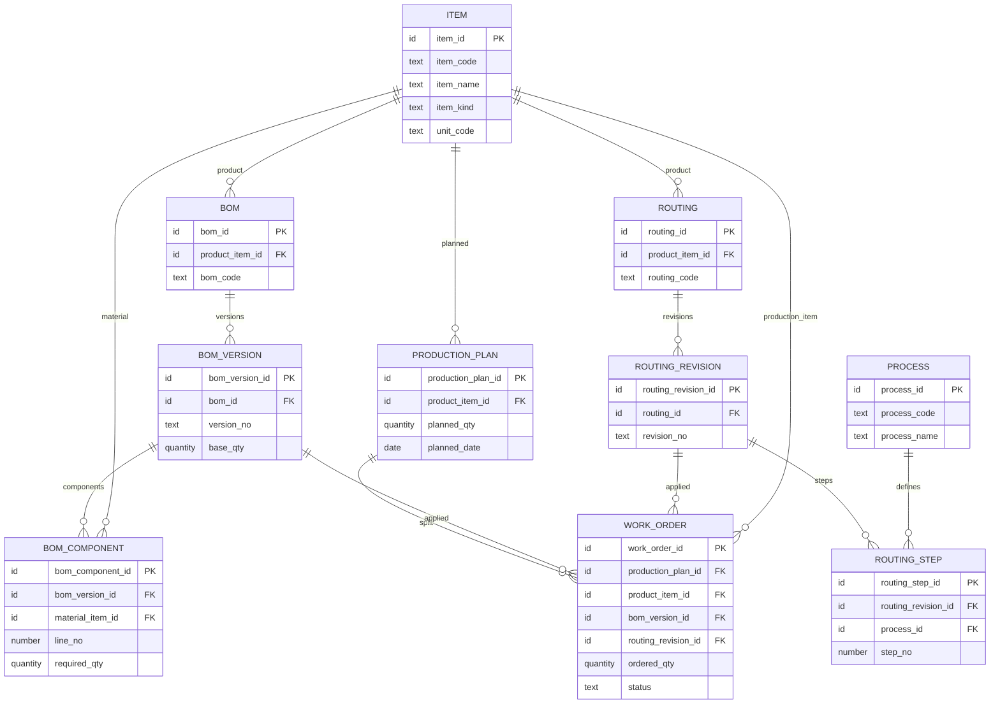
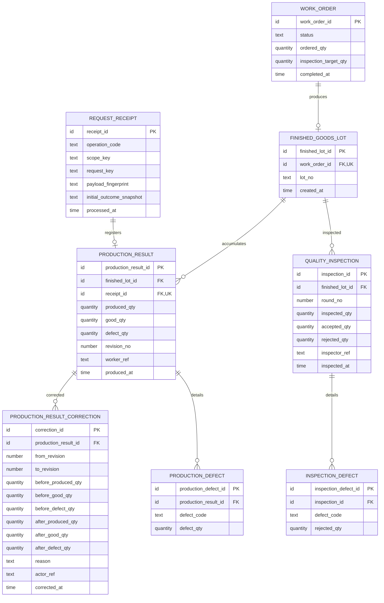
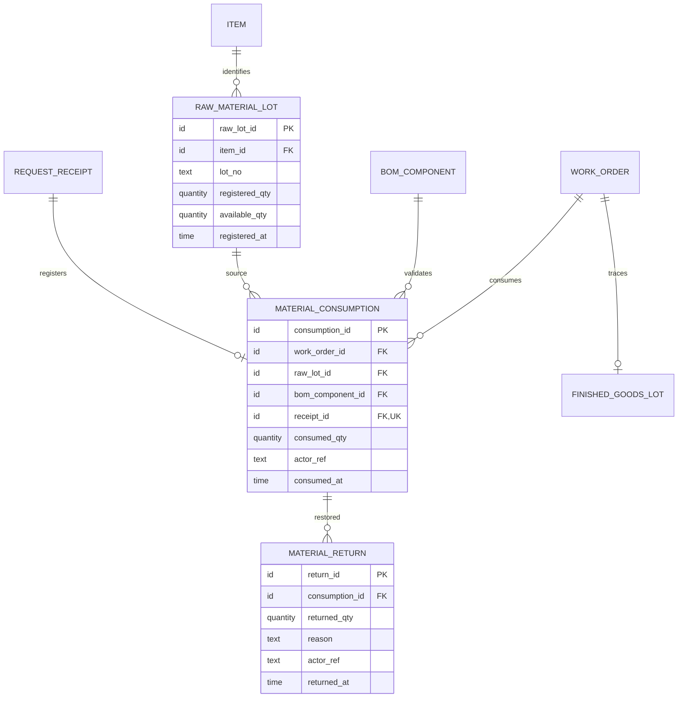

# Mini MES 논리 ERD 및 Domain Model 설계

- 상태: 논리 설계 초안. 승인된 업무 규칙을 표현하며 기술 추천안의 채택을 의미하지 않는다.
- 기준: `AGENTS.md`, `mini_mes_prd.md`, `business-rules.md`의 BR-01~BR-05 및 BD-01~BD-10
- 산출 범위: 관계, 속성, 무결성, 트랜잭션과 동시성의 문서 설계. Java·SQL·DDL·API·화면은 작성하지 않는다.

## 1. 설계 목적 및 범위

산업용 온도 센서 모듈의 계획 → 작업지시 → 원자재 소비·반환 → 생산실적 → 생산 완료 → 최종 검사 → LOT 역추적을 모델링한다. 센서 칩·PCB·케이스는 데모용 원자재 예시이며 보편적인 제조 정책이 아니다.

설계의 확정 수준은 다음과 같이 구분한다.

| 구분 | 의미 | 예 |
|---|---|---|
| A | 승인 정책에서 직접 도출되는 관계·불변식 | 작업지시당 완제품 LOT 최대 1개, 소비와 반환 연결 |
| B | 비교 가능한 기술 추천안. 업무 의미를 변경하지 않는 범위에서 검토 | 버전 테이블, 현재 실적과 정정 이력 분리, 요청 처리 기록 |
| C | 추가 업무 결정이 필요한 잠정 모델 | 물리적 중복 검사 식별, 부분 합격 요약 상태, 실적 취소 |

아래 ERD는 A와 B 추천안을 함께 표현한다. C에 의존하는 확장 관계는 본 도식에 확정 관계로 넣지 않고 7절·16절에서 대안을 설명한다. 테이블 수나 물리 컬럼명·길이·자료형은 최종 확정하지 않는다. 기존 PRD와 Business Rules는 변경하지 않는다. 설비·구매·출하·창고·재검사·재작업 기능을 추가하지 않는다.

## 2. 핵심 Domain Model

| 도메인 | 책임과 데이터 기준 |
|---|---|
| item | 품목의 지속적인 식별. 코드·구분·단위는 등록 후 고정, 명칭·사용 여부만 수정하며 PK·과거 참조 보존 |
| bom | 제품별 BOM 및 생산 당시 적용한 버전·구성·단위 소요량 보존 |
| process / routing | 공정 정의와 순서. 작업지시가 사용한 공정 구성을 보존 |
| production / workorder | 계획과 실행 단위 구분. 상태 전이·지시량·실적 누적·완료 판단 |
| lot | 원자재 LOT 수량과 실제 소비·반환 원장, 작업지시당 하나의 완제품 LOT 식별 |
| quality | 완료 시 생산 양품을 대상으로 검사 회차·합격·불합격 기록 |
| trace | 저장된 관계를 조회하여 역추적. 별도 추정 원장 생성 금지 |
| common | 요청 중복 방지 등 기술 기능. 생산·재고 정책을 공통 CRUD로 이동하지 않음 |

Service가 상태·수량·다중 행 규칙을 제어하고 Mapper는 조회·변경을 담당한다. 도메인 모델은 MyBatis로 저장할 업무 개념이며 JPA Entity나 DDD 프레임워크 도입을 의미하지 않는다. 생산실적 Service의 등록 업무가 LOT 생성까지 한 트랜잭션으로 조정할 수 있으나 세부 서비스 인터페이스는 후속 설계한다.

## 3. 엔티티 목록과 책임

| 논리 엔티티 | 목적 | 구분 |
|---|---|---|
| Item | 제품·원자재의 식별과 관리단위 | A |
| BOM | 생산 품목별 BOM의 지속적인 식별 | B: 버전과 분리 추천 |
| BOMVersion | 특정 버전의 기준 생산량과 구성 기준 보존 | A, 저장 분리는 B |
| BOMComponent | 해당 버전의 원자재와 단위 소요량 | A |
| Process | Routing이 참조하는 공정 정의 | A |
| Routing / RoutingRevision | Routing 식별과 변경 불가능한 적용 공정 구성 구분 | B: 버전 구조 추천 |
| RoutingStep | 해당 RoutingRevision의 공정·순서 | A |
| ProductionPlan | 생산 품목·계획수량·일정 | A |
| WorkOrder | 계획의 실행 단위, 적용 기준과 지시량·상태 | A |
| FinishedGoodsLot | 작업지시당 하나의 완제품 LOT 식별 | A |
| ProductionResult | 생산일시·작업자·생산·양품·불량의 현재 유효 기록 | A |
| ProductionResultCorrection | 정정 전후 값과 사유·작업자·버전 보존 | A, 구조는 B |
| RawMaterialLot | 원자재 품목·등록수량과 현재 가용수량 | A |
| MaterialConsumption | 작업지시별 실제 소비 확정 원본 | A |
| MaterialReturn | 원래 소비에 연결된 반환 기록 | A |
| QualityInspection | 최종 검사 회차의 대상·합격·불합격과 검사 이력 | A. 물리 대상 식별 보장은 C |
| ProductionDefect / InspectionDefect | 생산 불량과 검사 불합격의 사유별 상세 후보 | B, 상세 집계 정책은 C |
| RequestReceipt | 원자재 투입·실적 등록 요청의 고유 ID 및 성공 결과 연결 | B. 고유 ID·DB 유일성은 A |

Traceability는 위 FK의 조회 모델로 표현하며 별도 `lot_trace` 복사 테이블은 추천하지 않는다. 소비와 실적을 임의 배분하는 연결 테이블도 만들지 않는다. 모든 변경에 쓰는 범용 Audit Entity나 사용자 계정 테이블은 추가하지 않는다. 작업자·검사자 식별은 논리 속성으로 두고 실제 인증·권한 모델은 후속 결정한다.

## 4. 관계 및 Cardinality

| 부모 → 자식 | 관계 | 의미·추가 조건 |
|---|---|---|
| Item → BOM → BOMVersion → BOMComponent | 각각 1 : 0..N | 구성 확정 시 유효 구성 필요. 최소 행수·버전 발행 규칙은 별도 정책 |
| Item → BOMComponent | 1 : 0..N | 구성 원자재 식별. 현재 품목 상태로 과거 사용을 제거하지 않음 |
| Item → Routing → RoutingRevision → RoutingStep | 각각 1 : 0..N | Revision은 적용 공정 구성의 보존 단위 |
| Process → RoutingStep | 1 : 0..N | 공정 재사용 가능. BR-08: 공정 PK·코드와 기존 명칭 스냅샷 보존, 미사용 전환으로 기존 Step 변경 없음 |
| Item → ProductionPlan | 1 : 0..N | 계획의 생산 품목 |
| ProductionPlan → WorkOrder | 1 : 0..N | 작업지시는 정확히 한 계획 참조. 초과 배분은 정책 미확정 |
| BOMVersion / RoutingRevision → WorkOrder | 각각 1 : 0..N | 작업지시는 각각 정확히 한 적용 버전 참조 |
| WorkOrder → FinishedGoodsLot | 1 : 0..1 | 최초 실적 이전에는 없음, 최초 실적과 동시에 생성 |
| FinishedGoodsLot → ProductionResult | 1 : 0..N | 실적은 정확히 한 LOT 참조. 등록된 LOT은 정상 커밋 시 실적 1개 이상 필요 |
| ProductionResult → ProductionResultCorrection | 1 : 0..N | 일반 정정 이력. 실적 자체를 삭제하지 않음 |
| WorkOrder / RawMaterialLot / BOMComponent → MaterialConsumption | 각각 1 : 0..N | 하나의 소비는 각각 한 부모 참조. 적용 BOM·품목 일치 검증 필요 |
| MaterialConsumption → MaterialReturn | 1 : 0..N | 여러 부분 반환 가능. 반환합계 상한은 FK만으로 보장 불가 |
| FinishedGoodsLot → QualityInspection | 1 : 0..N | 한 LOT에 여러 최종 검사 회차 |
| ProductionResult / QualityInspection → 각 Defect 상세 | 각각 1 : 0..N | 사유 상세는 잠정. 부모의 불량수량과 자동 합산하지 않음 |
| RequestReceipt → MaterialConsumption 또는 ProductionResult | 각 1 : 0..1 | 성공 기록은 해당 작업 종류의 결과 하나에만 연결. 양쪽 동시 연결 금지 |

ProductionResult는 `finished_lot_id`를 통해 WorkOrder를 유일하게 찾는다. `work_order_id`를 중복 저장하지 않는 추천안으로 두 부모 불일치를 피한다. WorkOrder → FinishedGoodsLot → ProductionResult 경로로 작업지시별 실적을 조회한다. 물리 성능 때문에 중복 FK를 추가한다면 복합 FK 등 일치 보장 구조를 먼저 설계해야 한다.

## 5. 논리 ERD

표시 자료형은 논리 타입이다. PK/FK/UK는 제약 후보이며 조건부 필수·여러 행 제약은 본문을 함께 읽어야 한다. Mermaid의 0..N 관계만으로 LOT 생성 원자성이나 상태 조건이 보장되지는 않는다.

### 5.1 기준정보 및 생산계획

### 5.2 작업지시·실적·검사

`inspection_target_qty`는 완료 전 미확정이고, 완료 트랜잭션에서 확정되는 B 추천 속성이다. NULL을 업무 오류 우회에 사용하지 않고 완료 상태와의 조건부 필수 관계로 검증한다. 이 속성이 없으면 완료 후 불변인 실적 합계로 계산하는 대안도 가능하다. Defect 상세의 수량 의미·정정 이력 방식은 C이므로 도식은 잠정 후보이며, 해당 상세를 확정 구현해도 된다는 뜻이 아니다.

### 5.3 원자재 소비·반환과 추적 연결

ITEM, WORK_ORDER, BOM_COMPONENT, REQUEST_RECEIPT, FINISHED_GOODS_LOT는 이전 도식의 동일 엔티티다. MaterialReturn은 원래 소비에서 LOT·작업지시를 찾으므로 이들을 중복 FK로 두지 않는다. 소비와 반환을 단일 부호 수량 테이블로 합치는 대안보다 반환 대상의 실재성과 원본 FK가 명확하다. 투입 정정의 추가 관계는 9절의 B/C로 별도 표시한다.

## 6. 주요 속성·식별자 및 제약 후보

각 엔티티는 위 도식의 안정적인 대체 식별자를 PK로 갖는다. PK 생성 방식은 물리 설계에서 결정한다. 업무 코드·LOT 번호와 PK를 분리하여 코드 변경이 모든 이력을 재작성하지 않도록 한다.

| 대상 | 주요 FK·유일성 후보 | 주의사항 |
|---|---|---|
| Item | PK, 전역 업무 코드 UK | 기존 schema.sql과 품목 화면 승인 정책 적용 |
| Process | PK, 업무 코드 UK 후보 | 이번 품목 화면 보완에서 타 도메인 정책 변경 없음 |
| BOMVersion | bom_id FK, (bom_id, version_no) UK | 적용 버전의 구성·단위·기준량 보존 |
| BOMComponent | version FK, item FK, (version, line_no) UK | 2026-10-26 신규/편집 BOM은 동일 품목 중복 금지(BR-07). 기존 스키마는 유지하고 부모 잠금과 Service 검증 적용. 품목별 예상량은 구성행 합산 |
| RoutingRevision / Step | routing FK, (routing, revision_no) UK / revision·process FK, (revision, step_no) UK | BR-09: 등록·개정 추가·조회, 잠근 공정의 현재 명칭 스냅샷. 저장 개정 직접 수정은 미확정으로 제외. 병렬·반복 실행 정책을 추가하지 않음 |
| ProductionPlan | product_item_id FK | BR-10: 실제 PK ID로 등록·조회·검색. 현행 계획코드/상태/업무 UK 없음. 변경·취소 정책은 미확정이며 직접 수정·삭제 없음 |
| WorkOrder | plan·item·BOMVersion·RoutingRevision FK | BR-11: 제품 일치·양의 정수·현재 공정 활성 검증, 최초 사용과 지시 원자 저장. product_item_id·버전 PK 보존. 시작/시작 전 취소 제공 |
| FinishedGoodsLot | work_order_id NOT NULL FK + UK, lot_no UK | 10차 승인: 최초 실적의 사용자 입력 번호를 완제품 LOT 전체에서 전역 유일하게 보존. 원자재 LOT 번호와의 상호 중복은 허용 |
| ProductionResult | finished_lot FK, receipt FK + UK | 실적-LOT의 동일 작업지시 귀속은 단일 FK 경로로 표현 |
| ResultCorrection | result FK, (result, to_revision) UK | 현재 revision과 이전·이후 체인의 연속성은 트랜잭션 검증 |
| RawMaterialLot | item FK | LOT 번호 UK 범위·단위·등록량 정정 정책은 미확정 |
| MaterialConsumption | workorder·rawlot·component·receipt FK, receipt UK | component가 작업지시 적용 버전 소속인지, component 원자재와 rawlot 품목이 같은지 Service 검증 |
| MaterialReturn | consumption FK | 반환합계 상한은 부모·자식 집계 검증 |
| QualityInspection | finished_lot FK, (finished_lot, round_no) UK 후보 | 회차 번호 중복 방지는 물리적 제품 중복 검사 방지와 다름 |
| 각 Defect 상세 | result FK 또는 inspection FK | 범용 type/id 참조 대신 실제 FK 사용. 수량 상세 정책 승인 필요 |
| RequestReceipt | (scope_key, operation_code, request_key) UK 추천 | operation을 재시도마다 바꾸면 중복 방지가 안 됨. 서버가 작업 종류를 결정 |

이력과 참조 중인 기준정보에 대한 연쇄 물리 삭제는 추천하지 않는다. 참조 보존을 위한 삭제 제한 후보와 실제 사용자 삭제·비활성화 정책을 구분한다. 완료 LOT 삭제·실적 취소 정책이 승인되기 전에는 삭제 규칙이나 자동 복원을 설계 확정하지 않는다.

수량은 부동소수점 오차가 없는 정확한 수치 타입을 추천한다. EA 정수만 허용할지, 원자재 소수 단위를 지원할지와 단위 변환·반올림 정책은 **설계 결정 필요**다. 물리 정밀도·범위·NOT NULL·CHECK는 그 결정과 MySQL 버전에 맞춰 확정한다. 도식의 actor_ref는 사용자 FK가 확정된 것이 아니다.

### 과거 생산 기준의 보존: B 추천안

BOM은 식별 헤더 + 불변 Version + 해당 Component로, Routing은 헤더 + 불변 Revision + Step으로 보존한다. 작업지시는 생성 시 두 버전을 참조하고 이후 최신 버전을 따라가지 않는다. 사용된 버전의 내용·단위·구성 순서는 변경 불가로 보존하고 새 버전을 작성하는 방식을 추천한다. 2026-10-26 BOM에 대해서는 사용 이력 후 불변, 미사용 버전의 소요량 수정·구성 추가만 허용, 제거·교체는 새 버전, 물리 삭제 없음으로 승인했다(BR-07). 별도 발행 상태명·사용 가능 기간과 Routing 초안 수정 절차는 C다.

대안은 작업지시 생성 시 BOM·Routing을 복사하는 스냅샷 테이블이다. 원본 편집과 격리가 쉽지만 주문마다 구성 복제가 늘어난다. 본 설계는 공유 불변 버전 참조를 추천하며, 해당 버전을 변경 불가로 보호할 수 없다면 스냅샷이 필요하다. 1차 품목 화면의 승인 정책은 품목코드·구분·단위 변경 금지, 명칭·사용 여부 수정, 물리 삭제 금지다. RAW·SEMI·FINISHED 중 신규 등록은 RAW·FINISHED, 단위는 EA·M·G를 사용한다. 품목 created_by는 MES_ACTOR_ID 기반 개발용 식별자이며 인증 사용자 FK가 아니다. 품목·공정 이름의 당시 표시 스냅샷까지 보장하는 기능은 이번 구현에 포함하지 않는다.

## 7. 품질검사 대상 식별 모델 비교

| 기준 | A. LOT 수량 기반 | B. 생산실적별 대상 | C. 개별 제품·대상 식별 |
|---|---|---|---|
| 구조 | LOT-검사 회차와 수량 | 실적별 검사 가능량, 여러 실적이면 검사 배분행 필요 | 대상 ID·대상별 결과·검사 회차 연결 필요 |
| 복잡도·비용 | 낮음 | 중간 | 높음. 실제 대상 라벨·대응 절차 필요 |
| 다회 검사 | 남은 수량 내 회차 추가 | 실적별 잔량 및 회차 배분 | 미검사 대상 ID만 선택 |
| 수량 정합성 | LOT 누적 상한·회차 합계 보장 | 실적별 상한과 LOT 합계 보장 | 대상 개수·판정수량 일치 보장 |
| 중복 식별 범위 | 동일 회차·논리 배정 중복은 제한 가능. 동일 실물 재검사 식별 불가 | 동일 실적 초과 배정 방지. 실적 내 같은 실물 재검사는 식별 불가 | (대상 ID, 최종검사 종류) UK 등으로 같은 대상 기록 중복 방지 가능 |
| 실제 추적 수준 | LOT와 작업지시 | 생산실적까지 구분 | ID와 실물이 정확히 대응한다는 전제 아래 제품 수준 |
| 포트폴리오 설명 | 수량 불변식·잠금과 한계 설명 | 실적별 대상 배분 설계 설명 | 식별·라벨·다대다 처리까지 필요 |

**추천: A의 LOT 수량 모델을 MVP 기본안으로 채택 검토한다(B).** 작업지시당 LOT 하나, 완료 이후 검사, 개별 시리얼 요구 없음에 맞고 원자재 사용량을 실적에 배분할 필요도 없다. 회차 원본과 잔량을 원자적으로 검증하고 다음 단계로 실제 추적 수준을 확장할 수 있다.

그러나 A만으로 기존 BR-05의 '동일 대상 수량 중복 검사 방지'를 실물 수준까지 충족했다고 말할 수 없다. 예를 들어 양품 95에서 첫 검사 30개를 마친 뒤 같은 실물 30개를 다시 다른 회차로 등록해도 합계 60은 상한 이내다. B도 그 실적 내부에서는 같은 한계가 있다. 요청 ID나 회차 번호는 업무 요청 중복을 막을 뿐 새로운 요청으로 재검사한 실물을 식별하지 못한다.

**설계 결정 필요(C):** MVP 보장 범위를 LOT 단위 수량 배정과 검사 회차 기록으로 한정하고 실물 구분은 운영 절차로 보완할 것인지 개발자가 결정해야 한다. 이는 업무 해석·보장 범위 결정이므로 본 설계에서 기존 규칙을 완화하지 않는다. 그 결정 전에는 검사 모듈의 구현 확정이 불가능하다.

실물 수준 보장이 반드시 필요하면 C를 검토한다. 추가 `InspectionTarget`에 finished_lot_id와 대상 식별값, `InspectionTargetResult`에 inspection_id·target_id·결과를 두고 대상당 최종 결과 1개를 유일성으로 보호하는 잠정 대안이다. 결과는 같은 LOT 대상이어야 하며 제품 시리얼인지 용기·묶음 식별인지, 수량과 대응하는 범위는 추가 승인해야 한다. 임의로 1..95 가상 번호를 만들었다고 실제 개별 추적이 확보되지는 않는다. 본 ERD에는 이 확장을 확정 엔티티로 추가하지 않는다.

## 8. 생산 및 검사 수량 정합성

### 8.1 원천과 집계

| 수량 | 기준 데이터·계산 | 저장 추천 |
|---|---|---|
| 지시수량 | WorkOrder.ordered_qty | 원천 저장 |
| 생산·양품·불량 | ProductionResult 현재 유효 수량 | 각 원천 저장 |
| 누적 생산·양품·불량 | 해당 LOT 실적별 각 수량의 합 | 조회·검증 시 집계. 기본안은 중복 누적 컬럼 없음 |
| 완료 시 검사 전체 대상 | 완료 트랜잭션의 누적 양품 | WorkOrder.inspection_target_qty로 확정값 보존 추천. 유일한 LOT이 이를 참조 |
| 원자재 등록량 | RawMaterialLot.registered_qty | 원천 저장. 등록량 변경은 별도 미확정 정책 |
| 가용수량 | 등록량 - 전체 소비합 + 전체 반환합 | RawMaterialLot.available_qty 저장 추천. 소비·반환과 원자적 갱신 |
| 소비·반환 | MaterialConsumption / MaterialReturn | 각각 원천 저장, 원본 보존 |
| 순소비 | 소비 기록별 consumed_qty - 연결 반환합 | 계산. 복잡한 부호 보정 없이 검증 |
| BOM 예상 소요량 | 지시수량 / 적용 BOM 기준생산량 × 구성 소요량 | 계산. 동일 품목 구성행은 합산 |
| 실제-예상 차이 | 품목별 순소비합 - BOM 예상량 | 계산. 소비 총량·반환 총량도 함께 조회 |
| 검사 회차 수량 | QualityInspection의 inspected·accepted·rejected | 회차 원천 저장 |
| 누적 합격·불합격·검사 | 동일 LOT 검사 원천의 각각 합 | 계산 |
| 미검사 | 확정 검사 대상 - 누적 검사수량 | 계산 |
| 전체 부적합 통계 | 생산 불량합 + 검사 불합격합 | 중복 없는 대상인 MVP에서 계산. 실적 불량 원본 수정 금지 |

BOM 예상량은 지시량 기준임을 조회에 표시한다(B 추천). 진행률 기준 예상량을 추가하려면 지시량 기준과 혼용하지 않고 따로 정의해야 한다. 실제 총투입과 반환 후 순소비의 차이도 표시하여 반환이 실제 총투입 원본을 지우지 않게 한다. 예약 미도입을 확정하지 않았으므로 위 가용수량 산식은 **예약·창고 조정 등 추가 거래가 없는 범위의 기본안**이다. 예약 도입 결정이 있으면 가용·현재고의 개념부터 재설계한다.

누적 생산·검사합계는 부모 행으로 직렬화한 뒤 최신 자식 원천을 읽어 검증한다. 가용수량만 조건부 차감의 대상이므로 원장과 중복 저장한다. 집계 성능 측정 없이 모든 누적값을 컬럼으로 만들지 않는다. 성능상 누적 컬럼을 추가할 때는 모든 등록·정정·반환 경로에서 같은 트랜잭션으로 유지하고 원장과 대조할 기준을 정한다.

### 8.2 보장 위치

| 불변식 | DB 한 행 제약 후보 | Service·트랜잭션 검증 |
|---|---|---|
| 생산 = 양품 + 불량 | Result CHECK 및 각 수량 NOT NULL·비음수 후보 | 정정 전후·이력과 현재 revision 일치 |
| 누적 생산 ≤ 지시량 | 단일 CHECK로 불가 | 작업지시 잠금 후 최신 실적 합계, 등록·정정 반영 후 상한 검증 |
| 완료는 실적 존재·누적 생산 > 0·지시량 일치 | 상태와 시각·대상량의 행내 조건 후보 | 여러 실적 합계와 현재 상태·완료 전이 검증 |
| LOT 최대 1개 | FinishedGoodsLot.work_order_id UK + NOT NULL FK | 첫 실적·LOT 동시 생성과 최소 실적 1개 유지 |
| 가용수량 ≥ 0 | RawLot CHECK 후보 | 조건부 차감 성공 여부와 원장 동시 저장 |
| 반환합 ≤ 원래 소비 | 반환 행의 양수·FK 후보 | 원소비 잠금과 전체 반환합, 같은 LOT 복원 |
| 검사 회차 대상 = 합격 + 불합격 | Inspection CHECK 및 비음수·NOT NULL 후보 | 상태 COMPLETED, 잔여량·대상 중복 검증 |
| 검사합 ≤ 완료 양품 | 단일 CHECK로 불가 | 작업지시 잠금 후 확정 대상·최신 검사합 검증 |
| BOM 구성·품목 일치 | 개별 FK는 존재만 보장 | WorkOrder 버전 = Component 버전, RawLot 품목 = Component 품목 |
| 요청 재전송 중복 금지 | RequestReceipt UK, 결과 receipt_id UK | payload·대상 일치, 결과 재사용, 원자적 성공 기록 |

MySQL CHECK에는 다른 테이블 참조와 서브쿼리 제약이 있으므로 교차 행 합계를 CHECK로 보장한다고 설계하지 않는다. CHECK 지원·강제 여부는 사용할 MySQL 버전에서 확인한다. [MySQL CHECK 제약 문서](https://dev.mysql.com/doc/refman/8.4/en/create-table-check-constraints.html)

개별 기록 0수량 허용 범위는 미확정이다. 생산 양품·불량 중 하나가 0인 정상 사례는 표현해야 하지만 0 생산실적·0 검사 요청을 허용할지는 별도 결정한다. 완료 시 총생산 0 금지와 개별 행의 0 허용은 다른 정책이다.

## 9. 원자재 소비 및 반환·정정 모델

### 9.1 소비·반환 확정 관계(A)

소비 원본은 workorder·rawlot·applied component·수량·시각·작업자를 보존한다. 반환은 반드시 consumption_id를 참조한다. 반환 LOT과 작업지시를 입력값만으로 임의 지정하지 않고 소비 원본에서 결정한다. 등록 상태는 IN_PROGRESS이어야 하며 반환합이 원래 소비량을 넘지 않게 한다. 완료 이후에는 일반 반환·투입 정정을 하지 않는다.

등록 100 → 소비 60 → 반환 20이면 가용 60, 원소비 60, 반환 20, 순소비 40이다. 원소비를 40으로 덮어쓰지 않는다. 반환을 조회할 때 소비 원본 60을 여러 반환행 수만큼 중복 합산하지 않는다.

### 9.2 투입 정정 표현(B/C)

수량 감소 정정은 원본에 연결된 부분 반환으로, 증가 정정은 검증된 추가 소비로 표현하는 안을 추천한다(B). 잘못 선택한 LOT·품목 교체는 기존 소비의 허용된 반환과 올바른 LOT의 신규 소비를 하나의 정정 업무로 원자 처리하는 대안이다. 자동 재고 보정으로 실제 소비 사실을 만들어내지 않는다.

교체 정정을 채택한다면 MaterialReturn의 선택적 `replacement_consumption_id` FK와 신규 MaterialConsumption의 선택적 `corrects_consumption_id` 자기 FK를 두어 원본·반환·대체 소비 관계를 보존하는 B 확장안을 검토한다. 단순 반환에는 대체 소비가 없다. 관계가 서로 같은 작업지시를 가리키는지 검증해야 한다. 기본 도식에는 이 선택 관계를 확정 표시하지 않는다.

기록 오류 정정과 물리 반환의 구분, 실제 이미 소비된 자재를 어떤 증거로 정정할지, 교체의 부분 수량 허용은 **설계 결정 필요(C)**다. 오류 때문에 실제로 소비하지 않은 수량을 물리 반환했다고 기록해서는 안 된다. 승인된 IN_PROGRESS 허용·원본 보존·가용수량 정합성은 모든 대안에 유지한다. 생산실적 정정은 이 원장을 호출해 자동 수정하지 않는다.

## 10. 생산실적 정정 이력 모델

현재 ProductionResult와 append-only ProductionResultCorrection을 분리하는 B 추천안이다. 정정 시 result_id·예상 revision을 받고 WorkOrder를 먼저 잠근다. IN_PROGRESS 검증 후 현재 실적·버전과 최신 누적수량을 확인하고, 정정 후 누적 생산이 지시량 이내인지 검증한다. 현재 값 변경과 전후 값·시각·사유·작업자·revision 이력을 함께 커밋한다. 이력이 실패하면 현재 값도 변경하지 않는다.

원래 등록값은 첫 정정 이력의 before 값과 등록 요청 결과로 복원할 수 있고 모든 정정은 revision 체인으로 연결한다. 생산일시·작업자 등 변경 가능한 필드도 승인 범위에 들어오면 전후 이력에 포함한다. 불량 사유 상세를 수정한다면 그 상세의 전후 이력도 같은 트랜잭션에 포함해야 한다. 현재 추천 도식만으로 사유 상세 이력까지 완성되었다고 보지 않는다.

대안은 실적을 매번 불변 revision으로 저장하고 현재 revision을 가리키는 방식이다. 과거 값 조회는 명확하나 합계에 모든 revision을 포함하면 중복된다. MVP에는 현재 값 + 전후 이력이 단순하다. 정정 이력은 감사 목적이며 생산합계에 더하지 않는다. 사후 정정·실적 취소·음수 상쇄 실적을 임의 추가하지 않는다.

## 11. 중복 요청 방지 모델

### 11.1 B 추천: 업무 요청 전용 RequestReceipt

논리 키는 `(scope_key, operation_code, request_key)` UK를 추천한다. 세 값은 모두 필수이며 NULL로 유일성을 우회하지 않는다. scope_key는 동일 요청이 속한 호출 주체의 안정적인 범위이며 실제 계정·조직 범위는 권한 모델과 함께 **설계 결정 필요**다. 요청 고유 ID 사용과 DB 유일성 자체는 BD-07의 확정 정책이다. 정상 재시도는 같은 범위·작업 종류·키를 재사용하며, 내용이 다른 정상 업무는 다른 키를 사용한다.

서버가 정규화한 payload_fingerprint에 작업지시·LOT·수량 등 업무 입력을 포함한다. 같은 키·같은 내용은 기존 성공 결과를 조회하는 방식, 같은 키·다른 내용은 오류로 응답하는 방식을 추천한다(B). 정확한 HTTP 응답 형식·재시도 정책·보존 기간은 후속 설계다. 이 비교가 없으면 같은 키를 다른 작업지시에 재사용했을 때 잘못된 결과를 반환할 수 있다.

### 11.2 원자 처리와 결과 연결

요청 고유 키의 선점을 DB 유일성으로 보호하고 해당 트랜잭션 안에서 업무 변경·성공 결과 연결을 완료한다. 커밋된 Receipt는 실제 소비 또는 실적 한 건과 연결되어야 한다. MaterialConsumption.receipt_id와 ProductionResult.receipt_id의 FK·UK는 존재하는 Receipt 참조와 종류별 최대 1개를 보호한다. Receipt에 최소 하나의 업무 결과가 존재하는 조건, operation_code와 결과 종류 일치 및 두 종류에 동시에 연결되지 않는 조건은 Service에서 검증한다. 존재하지 않는 범용 target_type/target_id만 저장하는 구조는 추천하지 않는다.

같은 요청이 동시 도착하면 하나만 업무를 반영한다. 경쟁 요청은 먼저 처리 중인 트랜잭션의 결론을 확인한 후 성공 결과를 재조회하거나 실패한 원 요청의 롤백 후 다시 시도한다. 유일성 충돌을 예외 무시로 처리하지 않고 해당 트랜잭션 정리 후 새로운 읽기 범위에서 기존 성공 결과를 확인한다. 선점만 별도 커밋하여 처리 중 기록을 영구 방치하는 구조는 추천하지 않는다.

실패 시 요청 기록도 업무 변경과 함께 롤백한다는 B 추천이다. 동일 키 재사용 시 성공 결과가 있으면 현재 상태가 COMPLETED라도 새 실적을 등록하지 않고 최초 결과를 재조회한다. 최초 응답 재구성에 필요한 결과 식별자·당시 수량·revision 등은 initial_outcome_snapshot에 불변 성공 요약으로 보존한다. fingerprint만으로 원래 수량을 복원할 수는 없다. 이 속성은 업무 원장 대체가 아닌 재응답 자료이며 저장 형식과 응답 범위는 후속 설계다. 실적이 이후 정정되어도 재전송이 원래 수량으로 덮어쓰지 않으며, 원 요청 결과와 현재 실적 revision을 구분한다. 단순 시간 비교는 사용하지 않는다.

테이블 없이 업무 행마다 요청 키·fingerprint를 두는 대안도 가능하다. 공통 결과 재조회·대상 불일치 처리가 반복되므로 두 등록 업무에 한정한 Receipt를 추천한다. 검사·반환·정정까지 같은 기술을 확대할지는 별도 결정하며 승인 범위를 자동 확장하지 않는다.

### 11.3 8차 원자재 실제 소비 확정

원자재 소비의 후속 승인 계약은 BR-13과 database-design.md 10.1.1절을 따른다. 이 업무에 한해 MES_ACTOR_ID SHA-256 범위, UUID 요청 키, v1 정규화 payload SHA-256, 최초 성공 JSON·기존 소비 상세 재응답을 확정했다. 일반 추천안의 scope/응답 미확정 표현은 다른 미구현 업무에 계속 적용한다.

Receipt → WorkOrder → RawMaterialLot 순서와 조건부 차감·소비·성공 기록을 하나의 REQUIRES_NEW/READ_COMMITTED 트랜잭션으로 구현한다. Receipt UNIQUE 예외는 프록시 롤백 후 별도 REQUIRES_NEW 읽기 트랜잭션에서 완료 결과를 확인한다. 기존 성공이면 현재 상태/재고와 무관하게 최초 결과를 반환하며 다른 payload는 거부한다. 성공 JSON에 당시 재고 전후값을 보존하고 현재 가용수량과 구분한다. 기존 BOM 편집 잠금은 WorkOrder 뒤에 추가하지 않는다.

소비/반환 합계는 실제 원천을 독립 집계한다. BOM 예상량과 차이는 지시·원자재·보존 단위별 정확한 값 또는 나눗셈 식으로 표시한다. 반환 생성·재고 조정·실적·완제품 LOT·품질 기능과 스키마 변경은 포함하지 않는다. 실제 MySQL 성공 여부는 테스트 실행 전까지 미확인이다.

### 11.4 9차 원자재 실제 반환 확정

반환은 BR-14와 database-design.md 10.4.1절의 별도 승인 계약을 따른다. 기존 schema.sql은 MATERIAL_RETURN과 material_return.receipt_id FK/UNIQUE를 이미 지원하므로 변경하지 않는다. 위 일반 추천안 중 반환 요청 범위/재응답 미확정 표현은 이 승인 계약으로 대체한다.

작성자 SHA-256 범위·UUID, 원소비 ID/정규화 반환수량/원문 사유 fingerprint, 최초 성공 JSON과 상세 재응답을 사용한다. Receipt→WorkOrder→기존 MaterialConsumption→RawMaterialLot 잠금과 최신 반환합 검증·조건부 가용량 복원·반환 INSERT·Receipt 성공 기록을 하나의 REQUIRES_NEW/READ_COMMITTED 트랜잭션으로 처리한다. 소비 원본 수정/삭제·재고 조정·생산실적/완제품 LOT/품질 기능은 추가하지 않는다. 실제 MySQL 경합 검증은 별도 승인 실행이 필요하다.

## 12. 트랜잭션 경계

다음은 Spring Service 트랜잭션과 InnoDB를 전제로 한 B 기술 추천안이다. Mapper 여러 호출도 같은 트랜잭션·연결에 참여해야 한다. 업무 규칙은 Controller나 Mapper의 숨겨진 정책으로 분산하지 않는다.

| 업무 | 포함 데이터·필수 상태 | 원자적 변경 | 동시성 위험·제약 | 실패 시 |
|---|---|---|---|---|
| T1 최초 실적·LOT | Receipt, WorkOrder, LOT, Result. IN_PROGRESS | 요청 선점, LOT 1개 생성, 실적·결과 연결 | 작업지시 잠금, LOT.workorder UK, receipt UK, 실적 합계 검증 | LOT·실적·요청 기록 모두 미반영 |
| T2 추가 실적 | Receipt, WorkOrder, 기존 LOT·Result. IN_PROGRESS | 실적·요청 결과 저장 | 작업지시 잠금 후 최신 합계 + 신규수량 ≤ 지시량 | 새 실적·요청 기록 미반영, 기존 LOT 유지 |
| T3 실적 정정 | WorkOrder, 현재 Result, Correction 및 승인된 불량 상세. IN_PROGRESS | 현재 값·revision과 전후 이력 저장 | 작업지시 잠금, 기대 revision 확인, 정정 후 합계 검증 | 현재값·이력 모두 이전 상태. 원자재는 변경 없음 |
| T4 원자재 소비 | Receipt, WorkOrder, Component, RawLot, Consumption. IN_PROGRESS | 조건부 잔량 차감·소비 원본·요청 결과 저장 | 작업지시 상태 검증, rawlot 조건부 차감, 품목·버전 일치, receipt UK | 차감·소비·요청 기록 모두 롤백 |
| T5 원자재 반환 | WorkOrder, 원소비, 반환행, RawLot. IN_PROGRESS | 반환 저장·가용수량 복원 | 원소비 잠금 후 최신 반환합 검증, FK·양수 후보, 같은 LOT 조건부 복원 | 새 반환·복원 모두 미반영 |
| T6 작업지시 완료 | WorkOrder, LOT·실적 원천. IN_PROGRESS | 실적 존재·누적 생산 > 0·지시량 일치 확인 후 상태·완료시각·검사대상 확정 | 등록·정정·소비·반환과 같은 작업지시 잠금. 대상은 양품합 | 미달·실적 없음이면 완료 거부, IN_PROGRESS 유지 |
| T7 최종 검사 | WorkOrder, LOT, 기존 검사, 신규 검사·사유. COMPLETED | 잔여량 검증 후 검사 회차 저장 | 작업지시 잠금 후 최신 검사합, 회차 UK·행내 합계, 물리 중복 보장은 7절 결정 필요 | 새 검사·상세 미반영, 작업지시 상태 유지 |

READY 시작·취소도 동일 작업지시 행을 잠그고 허용 전이와 관련 이력 존재 여부를 검증하는 방향이다. 작업지시 생성 시 BOM·Routing 버전·생산 품목의 일치를 검증한다. 생산계획 배분 상한과 계획 변경·취소 처리의 트랜잭션은 정책 확정 후 정하며 임의로 100% 배분 제한을 추가하지 않는다.

## 13. 동시성 및 무결성 검토

### 13.1 불변식별 제어 수단

| 수단 | 추천 용도 | 한계·대안 |
|---|---|---|
| DB Unique Constraint | 작업지시당 LOT 1개, 요청 키, 회차·revision 중복 | 상태·누적 수량·실물 중복 검사까지 보장하지 않음 |
| 조건부 UPDATE 개념 | 원자재 available ≥ 요청수량일 때만 차감, 영향 행수 확인 | 0행이면 실패, 소비 이력도 저장하지 않음. 사전 조회만으로 대체 불가 |
| 부모의 배타 행 잠금 | WorkOrder별 실적 등록·정정·완료·검사 직렬화, 원소비별 반환 상한 | 처리량은 제한됨. 부모 잠금 규약을 우회하는 writer가 없어야 함 |
| 낙관적 revision 검증 | 오래된 화면의 실적 정정 덮어쓰기 방지 | 충돌 시 재검토 필요. 단독으로 자식 합계 불변식을 보장하지 않음 |
| 누적값 별도 저장 | 대규모 집계 성능이 필요할 때 검토 | 모든 정정 경로의 원자 갱신·원장 대조가 필요하므로 기본안에서 제외 |

같은 작업지시의 상태 또는 관련 수량을 바꾸는 모든 업무는 WorkOrder를 공통 직렬화 기준으로 삼고 그 행의 배타 잠금을 먼저 확보하는 추천안이다. 원자재는 이에 더해 rawlot의 조건부 수량 변경을 사용하고, 반환은 원소비 행을 잠가 반환합계 상한을 보호한다. 조회 화면에는 일괄 잠금을 적용하지 않는다.

### 13.2 잠금 순서와 최신 집계

추천 잠금 순서는 요청 키 선점(해당 등록만) → WorkOrder → 기존 MaterialConsumption(반환 시) → RawMaterialLot 순이다. 여러 원소비·원자재 LOT을 변경하는 정정안이 채택되면 각 종류 안에서 ID 오름차순을 사용한다. 실적 자식 행은 부모를 먼저 확보한 뒤 읽고 변경한다. 데드락·잠금 대기 실패 시 업무 전체를 롤백하며 부분 재시도로 수량을 복원하지 않는다. 재시도 횟수와 사용자 안내는 후속 기술 설계다.

InnoDB 잠금 읽기는 명시적인 트랜잭션 안에서 사용해야 하며 커밋·롤백까지 보호된다. 단순 부모 조회나 Java 객체의 상태 확인을 DB 잠금과 동일시하지 않는다. [MySQL 잠금 읽기](https://dev.mysql.com/doc/refman/8.4/en/innodb-locking-reads.html)

**오래된 합계 주의:** 부모 행을 잠갔다고 앞서 형성된 일반 조회 스냅샷이 자동 갱신되지는 않는다. REPEATABLE READ의 기존 스냅샷으로 실적·검사·반환 합계를 재조회하면 직전 경쟁 요청의 커밋이 빠질 수 있다. 이 설계는 수량 변경 트랜잭션에 READ COMMITTED를 사용하는 안을 추천하고, 부모 잠금을 확보한 뒤 해당 자식의 최신 합계를 조회한다. 모든 writer가 같은 부모 잠금 규약을 지키는 것이 전제다. 프로젝트의 실제 격리수준을 아직 정하지 않았으므로 REPEATABLE READ를 유지할 경우 현재 읽기 기반 자식 조회·합계 전략을 별도로 검증해야 한다. [MySQL 일관 읽기와 격리수준](https://dev.mysql.com/doc/refman/8.4/en/innodb-consistent-read.html)

### 13.3 경합별 결과

| 경합 | 보장해야 할 결과 |
|---|---|
| rawlot 잔량 40, 서로 다른 작업지시에서 소비 30씩 | 조건부 차감으로 하나만 성공, 최종 가용 10. 실패 소비 기록 없음 |
| 원소비 60, 반환 40씩 동시 요청 | 원소비 잠금과 최신 반환합으로 하나만 성공. 합계 80 금지 |
| 같은 작업지시 첫 실적 60·40 동시 등록 | 순서대로 실행, 한 LOT만 생성, 서로 다른 정상 키 두 실적 저장. 누적 100 |
| 같은 작업지시 실적 60·60 동시 등록 | 하나 성공 후 다음은 누적 120이므로 거부. 두 요청이 다르다고 무조건 성공시키지 않음 |
| 실적 등록과 완료 동시 요청 | 완료 먼저 잠그면 당시 합계로 판단. 미달이면 거부·재요청 필요. 실적 먼저면 새 합계로 완료 판단. 완료 후 등록 금지 |
| 같은 LOT 미검사 35, 검사 30씩 동시 요청 | 하나만 저장, 다음은 잔여 5를 초과하여 거부. 물리 대상 중복 식별은 별개 |
| 같은 요청 키 동시 등록 | 업무 반영은 최대 1회. 동일 내용 결과 재조회, 다른 내용은 추천 정책에 따라 거부 |

### 13.4 조회 집계 중복 방지

실적 2행·소비 3행·반환 2행·검사 2행을 한 번에 조인해 합산하면 행 곱으로 수량이 부풀 수 있다. 실적은 LOT별, 반환은 원소비별, 소비 순량은 작업지시·원자재 LOT별, 검사는 LOT별로 먼저 집계한 결과를 결합한다. ProductionResultCorrection과 Defect 상세는 합계 원천에 다시 더하지 않는다. 조회 일관성이 필요하면 한 시점의 조회 트랜잭션 또는 한 쿼리의 사전 집계 결과로 보여준다. 조회용 요약을 새로운 소비 원장처럼 사용하지 않는다.

## 14. 대표 업무 시나리오의 데이터 흐름

| 시나리오 | 필요한 엔티티·관계 | 데이터 흐름과 검증 위치 |
|---|---|---|
| 1. 계획 200 → 지시 100씩 2건 | Item, Plan, WorkOrder, BOMVersion, RoutingRevision | 계획 1행·작업지시 2행. 각각 적용 버전과 제품 일치 검증. 200 분할은 표현 가능하며 초과 배분 허용 여부는 미확정 |
| 2. rawlot 100 → 소비 60 → 반환 20 | RawLot, Consumption, Return, WorkOrder | T4 차감 후 40. T5 원소비 연결 반환 후 60. 소비 60·반환 20·순소비 40을 각각 조회 |
| 3. 지시 100, 실적 60/57/3 + 40/38/2 | WorkOrder, 단일 FinishedLot, Result 2행, Receipt 2행 | T1 첫 LOT+실적, T2 동일 LOT 추가. 누적 100/95/5 확인. T6 완료 시 검사 대상 95 확정 |
| 4. 완료 후 검사 60/58/2 + 35/34/1 | FinishedLot, WorkOrder 완료 대상, Inspection 2행 | 첫 검사 후 미검사 35. 둘째 후 합격 92·불합격 3·미검사 0. 생산불량 5는 유지, 전체 부적합 통계 8. 물리 중복 여부는 7절 결정 전 미보장 |
| 5. 최초 실적 요청 2개 동시 | WorkOrder, Receipt, FinishedLot, Result | 서로 다른 키는 각각 검증. 작업지시 잠금·LOT UK로 1개 LOT, 정책 내 합계면 2개 실적. 한 요청 실패가 이미 커밋된 다른 정상 요청을 취소하지 않음 |
| 6. 잔량 40에서 소비 30씩 2개 | RawLot, 각 Consumption·Receipt, WorkOrder | T4 조건부 차감·영향 행수 검증으로 가용수량 음수 금지. 전체 성공 소비 30, 잔량 10 |
| 7. 등록과 완료 경합 | WorkOrder, FinishedLot, Result, 완료 검사대상 | 동일 작업지시 잠금으로 순서 확정. 완료 당시 최신 누적이 정확히 100이고 실적이 있을 때만 완료. 이후 추가·정정 차단 |

추가 정정 예: IN_PROGRESS의 실적 60/57/3을 60/56/4로 고치면 현재 실적·revision·전후 이력을 T3에서 갱신한다. 생산합계는 유지하고 양품·불량 합계를 다시 계산한다. 원자재 소비 60은 자동 변경하지 않는다. COMPLETED 이후 동일 변경은 거부한다.

역추적은 FinishedLot → WorkOrder → 적용 BOMVersion·RoutingRevision, WorkOrder → Consumption → RawLot 및 Return, FinishedLot → Result·Correction·생산불량 상세, FinishedLot → Inspection·검사불합격 상세 경로다. 작업지시 단위 원자재 연결이므로 특정 실적 1행이나 제품 1개가 어느 rawlot을 썼는지는 임의 추정하지 않는다.

## 15. 설계 대안 및 선택 근거

| 판단 | 추천 및 이유 | 대안·미선택 이유 | 상태 |
|---|---|---|---|
| 생산 기준 보존 | 공유 불변 BOMVersion·RoutingRevision 참조. 적용 이력과 재사용을 함께 표현 | 작업지시별 구성 복사: 격리는 좋으나 복제량 증가 | B. 변경·발행 정책은 C |
| 완제품 LOT과 실적 | LOT.workorder UK, Result는 LOT FK만 보유. 두 귀속 경로 충돌 방지 | Result에 작업지시 FK도 중복: 추가 복합 일치 제약 필요 | 관계 A, 정규화 구조 B |
| 원자재 이력 | 소비와 반환 분리, 반환은 원소비 FK. 의미·순소비 검증 명확 | 부호 거래 단일 테이블: 거래별 허용 조합·참조 검증 증가 | B |
| 실적 정정 | 현재 실적 + 전후 정정 이력. 합계 원천이 하나 | 모든 revision 불변 저장: 현재 revision 선택 오류 시 중복 합산 | B |
| 검사 대상 | LOT 수량 모델 추천. 비용과 현재 LOT 추적 범위에 적합 | 실적별 대상도 실물 중복을 못 막음. 개별 시리얼은 식별 운영 필요 | B, 물리 보장 범위 승인 C |
| 중복 요청 | 두 등록 업무에 한정한 Receipt와 DB UK·payload 비교 | 업무별 키 컬럼 반복 / 시간창 비교는 정상 반복·재전송 구분에 부적합 | B, ID 사용·DB 유일성 A |
| 수량 저장 | 원천 중심, rawlot 가용량과 완료 검사대상만 이유 있는 중복 저장 | 모든 누적값 저장: 정정 경로마다 갱신 누락 가능 | B |
| Traceability | 실제 FK 경로와 사전 집계 조회 | lot_trace 복사: 원본·정정·반환과 동기화 부담 | B |

가장 중요한 판단은 (1) 작업지시당 LOT 1개를 DB 유일성으로 보호하고 첫 실적과 원자 생성, (2) 소비·반환·실적·검사 원천을 분리하여 수량과 과거 이력을 보존, (3) 수량 기반 검사와 물리 대상 식별의 보장 범위를 구별하는 것이다.

### 요구사항 대조

| 기준 | 본 문서 대응 | 검토 결과·한계 |
|---|---|---|
| BR-01 / BD-08 | 4~6·12절 LOT UK, T1 | 최초 실적과 LOT 원자 생성 표현 가능 |
| BR-02 / BD-02·04·07 | 8~9·11~13절 | BOM 편차 비차단, 원소비 FK 반환·요청 UK. 투입 정정의 세부 표현은 추천·미확정 구분 |
| BR-03 / BD-01·05·09 | 8·12~14절 | 실적 존재·누적 생산 = 지시량·0금지, 완료 후 변경 금지 |
| BR-04 | 13.4·14절 역추적 | 실제 순소비 조회 가능. 실적별 원자재 배분 없음 |
| BR-05 / BD-06·10 | 7~8·12절 T7 | 완료 양품 대상·수량 분리. 물리적 중복 검사 방지의 해석은 미결정 |
| BD-03 | 10절 T3 | IN_PROGRESS 정정·전후 보존·원자재 독립. 취소 미확정 |
| FR-01~04 | 3~6절 Item·BOM·Process·Routing | 기준정보와 적용 버전 보존. 발행·단위변경 정책 후속 결정 |
| FR-05~06 | Plan·WorkOrder | 계획 분할·상태 전이 표현. 계획 변경·초과 배분 후속 결정 |
| FR-07~09 | 원자재 원장·Result·FinishedLot | 수량 원천과 반환·정정·LOT 연결 표현 |
| FR-10~11 | Defect 후보·Inspection | 생산 불량·검사 불합격 분리, 상세 유형 집계·요약 상태는 미확정 |
| FR-12 | FK 역추적·사전 집계 | 실제 연결 조회. 물리적 제품 단위 추적 미제공 |

정적 검토 결과 7개 대표 수량·경합 시나리오는 추천 모델로 설명할 수 있다. 다만 검사 물리 대상 중복 보장, Defect 상세 정책과 취소 등 C 항목까지 해결되었다는 뜻은 아니다. 실제 DB·SQL·잠금·Mermaid 렌더링 검증은 수행하지 않았다.

## 16. 미확정 업무 정책과 후속 작업

### 16.1 업무 결정 필요(C)

| 항목 | 결정과 영향 |
|---|---|
| 검사 대상 중복의 보장 수준 | LOT 수량 운영 승인 또는 실물 식별 필요. 검사 대상 관계와 구현 착수에 직접 영향 |
| 생산실적 취소 | 허용 조건·연결 이력·집계 반영 미확정. 삭제·음수 상쇄·LOT 자동 삭제를 가정하지 않음 |
| 부분 합격 LOT 요약 상태·가용수량 | 수량 분리는 확정, 상태명·판정·사용 가능량은 미확정. 검사 합격을 임의로 출하 가능량으로 선언하지 않음 |
| 원자재 예약 | 현재고·가용량 정의와 원장·잠금 범위에 영향. 예약 엔티티를 자동 포함하지 않음 |
| 완료 LOT·참조 기준정보 삭제 | 보호 FK 추천과 실제 업무 삭제 정책 구분. 이력 연쇄 삭제 설계 금지 |
| BOM·Routing 발행·변경 | BOM 사용 후 불변·미사용 버전 소요량 수정/구성 추가는 BR-07로 확정. BOM 발행·활성기간·다단계 구성 및 Routing 변경 정책은 후속 결정 |
| 계획 변경·취소·초과 배분 / 지시 변경 | 과거 작업지시 기준·수량 변경 허용 범위를 승인 전 확정하지 않음 |
| 단위·0수량·코드 유일성 | 10차 신규 생산실적은 양의 EA 정수, 완제품 LOT은 전역 UNIQUE·사용자 입력으로 확정. 그 밖의 미확정 단위·코드 정책은 별도 결정 |
| 불량 상세 정책 | 복수 원인 수량 중복과 부모 불량합 관계, 상세 정정 이력을 결정 |
| 투입 기록 오류 정정의 의미 | 물리 반환과 기록 오류 보정을 구분. 미소비 자재를 반환한 것으로 기록하지 않음 |

### 16.2 후속 기술 설계(B)

1. 추천 모델의 PK 생성·정확한 수량 타입·제약·인덱스를 정한다. 후보 인덱스는 Result(finished_lot_id), Inspection(finished_lot_id), Consumption(work_order_id, raw_lot_id), Return(consumption_id), Correction(result_id, to_revision) 및 FK 조회 경로다. 실제 쿼리와 함께 확정한다.
2. 원자재 소비 계약은 11.3절로 확정했다. 다른 업무의 요청 키 범위·payload 정규화·중복 결과 응답·보존 기간·결과 종류 일치를 구체화한다.
3. MySQL 버전·InnoDB·격리수준을 확정하고 최신 집계 읽기, 잠금 순서·조건부 수량 변경·rollback·데드락 재시도를 설계한다.
4. 반환·투입 정정·실적 정정 상세 이력 구조를 C 결정에 맞게 보완한다.
5. 검사 보장 범위를 승인한 다음 대상 식별 또는 수량 모델의 논리 배정·재전송 방지 구조를 확정한다.
6. 결정 이후 별도 승인된 작업에서 DDL·Backend 설계와 Business Rule 중심 검증 계획을 작성한다. 본 작업에서는 문서에서 종료한다.

### 16.3 기존 문서 문제 보고 및 착수 판단

- 기존 승인 정책끼리 새로운 직접 충돌은 확인하지 못했다. 다만 BR-05의 동일 대상 중복 방지는 검사 대상의 실물 식별 수준이 미정이므로 수량 상한만 구현하고 충족했다고 주장할 수 없다. 이 문서는 문제를 보고하며 기존 규칙을 수정하지 않는다.
- PRD 4절의 순서상 LOT 연결이 검사 이후에 보이지만 같은 절과 FR-09는 첫 실적 시 생성을 명시한다. 본 설계는 그 명시 규칙을 따라 첫 실적에서 연결하고, 이후 단계는 연결 조회로 해석한다. 원문은 수정하지 않았다.
- 논리 관계 설계는 진행 가능하다. Backend 전체 구현 확정 전에는 최소한 검사 보장 수준·적용 버전 보존 방식·기록 오류 정정·불량 상세 수량 정책을 검토해야 한다. 미확정 취소·예약·삭제 기능을 기본 동작으로 구현해서는 안 된다.

참고: DB 기능의 제약과 잠금 읽기·스냅샷 특성은 위 MySQL 공식 문서를 근거로 확인했다. 해당 문서는 제품 업무 정책의 근거가 아니며 기술 추천의 참고자료다. 브라우저·개발 서버·빌드·테스트·실제 DB 실행·Commit·Push는 수행하지 않았다.
